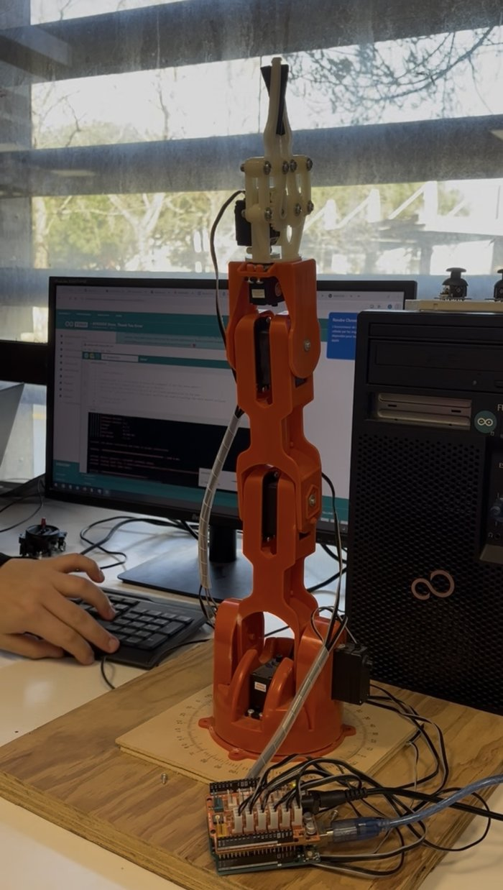

# El Chappo The Arm

A robotic arm I built from A to Z, by replicating the parts of Arduino's orange robotic arm kit (Braccio), plus the web app to drive it remotely from a phone or a computer.

**🎮 Live demo of the interface:** [lesa3w.github.io/El_Chappo](https://lesa3w.github.io/El_Chappo/)

<p align="center">
  
</p>

## How it works

```
Browser (joysticks)  →  Flask server (Python)  →  Arduino relay  →  HC-05 Bluetooth  →  robotic arm
```

- **Web interface**: two joysticks, gripper control (open, close) and a reset button, with live feedback of each motor's angle and of the connection state.
- **Flask server** (`server/server.py`): receives the commands from the page and forwards them over a serial link.
- **Arduino relay** (`server/arduino_server.ino`): passes every command from the PC to the arm through an HC-05 Bluetooth module.

## Stack

JavaScript · HTML · CSS · Python (Flask, pyserial) · Arduino
